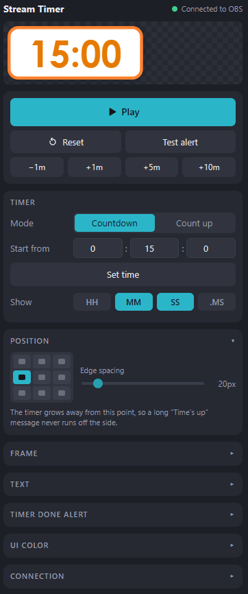
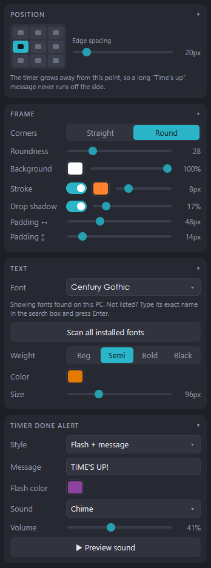

# ⏱️ Stream Timer for OBS

A simple, customizable on-screen timer for OBS, controlled from a dock right inside OBS.

<p align="center">
  
  &nbsp;&nbsp;
  
</p>

Hi! I'm **Bears**, the creator of Stream Timer for OBS.

I wanted to make a timer plugin that's easy and simple to use, so you can set it up in a few minutes and get back to streaming. The instructions are below, but if you run into any issues or have ideas to make it better, please let me know! You can [open an issue](../../issues) here on GitHub or email me at **bearsinalaska@gmail.com**.

Thanks for using it and happy streaming! 🐻

## ✨ Features

- **Countdown or count up**, with quick −1m / +1m / +5m / +10m buttons
- **Choose what to show:** any mix of HH : MM : SS . MS
- **Style it your way:** font (including fonts installed on your PC), weight, color, size, background, stroke, rounded corners, and drop shadow
- **9-point positioning:** the timer grows away from its anchor, so it never runs off screen
- **"Time's up" alert:** flash, a custom message, or both, plus a sound (built-in chime, your own file, or a sound pack)
- **Personalize the panel** with your own UI color
- **Live preview** right in the control panel
- Settings **save automatically** and come back every time you open OBS
- **Doesn't touch your scenes** or anything else in OBS

## 🎨 Make it yours

Match the control panel to your stream's colors with **UI Color**. Pick one of the presets, choose any color from the color wheel, or type in your brand's hex code. Button text switches between light and dark automatically so it always stays readable.

<p align="center">
  
  &nbsp;
  
  &nbsp;
  
</p>

## 📋 Requirements

- **OBS Studio 28 or newer** (WebSocket is built in)
- Windows, macOS, or Linux

## 📦 Download

1. Click the green **Code** button at the top of this page, then **Download ZIP**.
2. Unzip it somewhere permanent, like your Documents folder.
   If you move the folder later, redo steps 2 and 4 below with the new location.

Keep all the files together in the same folder:

| File | What it does |
|---|---|
| `timer-control.html` | The control panel. Lives inside OBS as a dock. |
| `timer-overlay.html` | The timer your audience sees. Added as a Browser Source. |
| `sounds/` | Optional alert sounds for when the timer finishes. |

## 🛠️ Setup (about 3 minutes)

### 1. Turn on OBS WebSocket
1. In OBS, go to **Tools → WebSocket Server Settings**.
2. Check **Enable WebSocket server**, and leave **Enable Authentication** checked.
3. Click **Show Connect Info** and copy the **Server Password**.
4. Click **OK**.

### 2. Add the control panel as a dock
1. Drag `timer-control.html` into Chrome or Edge and copy the address from the address bar. It looks like this:
   `file:///C:/Users/YourName/Documents/Stream%20Timer/timer-control.html`
2. In OBS, go to **Docks → Custom Browser Docks…**
3. Set **Dock Name** to `Stream Timer` and paste the address into **URL**.
4. Click **Apply**, then **Close**. Drag the panel wherever you like in your OBS layout.

### 3. Connect the panel
1. In the panel, open the **Connection** section at the bottom.
2. Paste the WebSocket password from step 1.
3. Click **Save & connect**. The dot at the top turns green and says **Connected to OBS**.

### 4. Add the timer to your scene
1. In the panel's **Connection** section, click **Copy overlay URL**.
2. In OBS, select your scene and add a new source: **+ → Browser**.
3. In the Browser Source properties:
   - **Uncheck "Local file"** (important!)
   - **URL:** paste the overlay URL
   - **Width / Height:** your full canvas size, e.g. `1920` × `1080`
   - Check **Control audio via OBS** if you want the alert sound to be heard on stream
4. Click **OK**.

**Done!** Press **Play** in the panel to test it.

## 🎮 Using it

| Section | What it does |
|---|---|
| **Play / Pause / Reset** | Main controls at the top of the panel |
| **−1m / +1m / +5m / +10m** | Add or remove time, even while it's running |
| **Test alert** | Shows the "time's up" alert for 5 seconds |
| **Timer** | Countdown or count up, starting time, and which units to show |
| **Position** | Where the timer sits on screen, and how far from the edge |
| **Frame** | Corners, background color and opacity, stroke, drop shadow, padding |
| **Text** | Font, weight, color, and size. If your font isn't listed, type its exact name in the search box and press Enter. |
| **Timer done alert** | Flash, message, or both, plus the alert sound |
| **UI Color** | Change the panel's highlight color with a preset, the color wheel, or a hex code. This only changes the panel, not the on-stream timer. |

## 🔔 Alert sounds

Pick a sound under **Timer done alert → Sound**:

- **Chime:** built in
- **Sound pack:** files in the `sounds` folder (see below)
- **My own file…:** choose any audio file up to 3.5 MB
- **File path on this PC…:** paste a full path, e.g. `D:\Sounds\ding.mp3`
  (Shift + right-click a file → **Copy as path**)

**To add sounds to the pack:**
1. Copy `.mp3`, `.wav`, or `.ogg` files into the `sounds` folder.
2. Open `sounds/sounds.js` in Notepad and add a line for each file:
   ```js
   { name: 'Bell', file: 'bell.mp3' },
   ```
3. Save, then right-click the panel → **Reload**.

## 🩹 Troubleshooting

<details>
<summary><b>The dot is red / "OBS WebSocket offline"</b></summary>

Make sure **Enable WebSocket server** is checked (Setup step 1).
</details>

<details>
<summary><b>"Wrong password"</b></summary>

Copy the password again from **Show Connect Info** and click **Save & connect**. If you change the password later, also redo Setup step 4, because the overlay URL includes it.
</details>

<details>
<summary><b>The panel works but the timer doesn't move on screen</b></summary>

Make sure **Local file** is unchecked in the Browser Source and the URL came from **Copy overlay URL**. Then click **Refresh cache of current page** in the source properties.
</details>

<details>
<summary><b>The panel or timer looks out of date after an update</b></summary>

Right-click the panel → **Reload**, and click **Refresh cache of current page** in the Browser Source.
</details>

<details>
<summary><b>The alert sound plays on my PC but not on stream</b></summary>

Check **Control audio via OBS** in the Browser Source, and make sure its fader isn't muted in the Audio Mixer.
</details>

## 🔒 Privacy

- Your password and settings are saved inside your own OBS, not in these files. Sharing this folder never shares them.
- **Don't share your overlay URL.** It contains your WebSocket password.

## 💬 Feedback & contact

Found a bug or have an idea? I'd love to hear it!

- **[Open an issue](../../issues)** here on GitHub
- **Email:** bearsinalaska@gmail.com

If Stream Timer helps your stream, a ⭐ on this repo means a lot!
